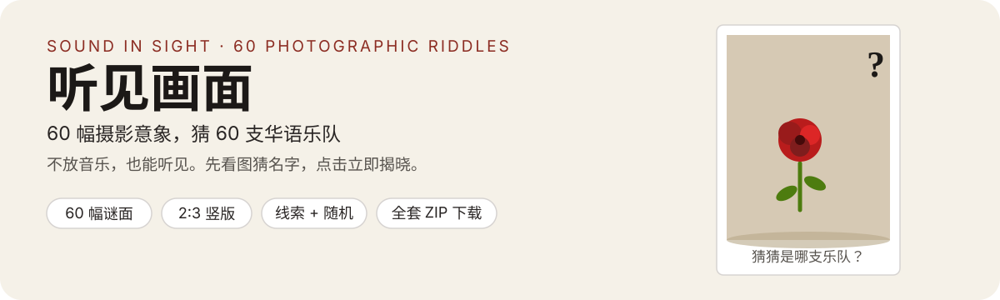
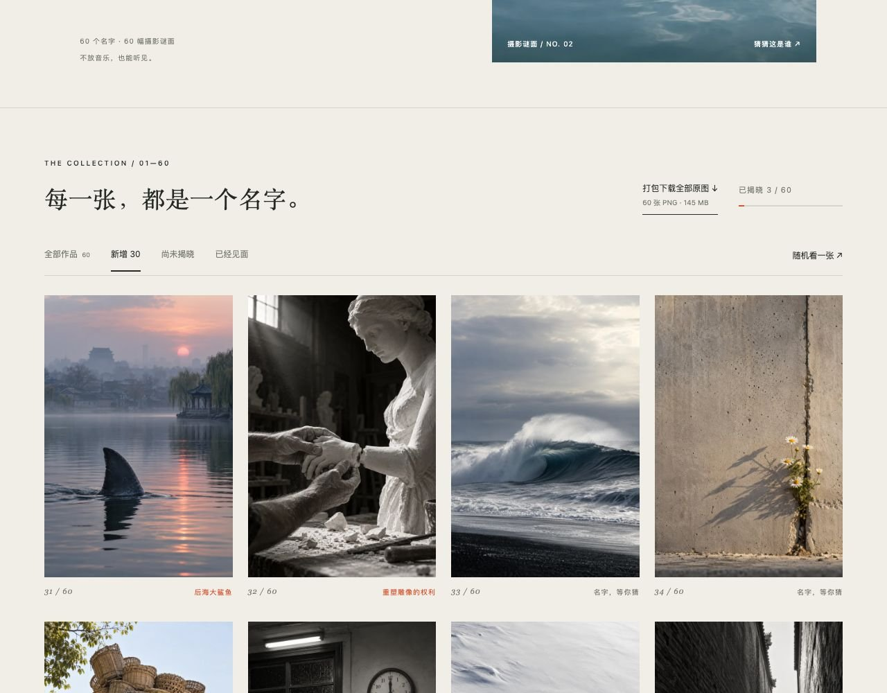

<p align="right"><a href="README.md">中文</a></p>

<p align="center">
  
</p>

<p align="center">
  <a href="https://xiaosang.cc/rock-in-pictures/">▶ Play Online</a>
  ·
  <a href="https://github.com/holynova/rock-in-pictures">GitHub Repository</a>
</p>

60 Chinese rock and indie band names turned into 60 photographic riddles: Second Hand Rose is a rose being passed on; Orange Ocean is a single orange floating on a still sea. Guess the name from the image, click to reveal instantly — with optional clues, random browsing, Traditional/Simplified answers, saved progress, and single original downloads. Every photo is a 1024×1536 portrait. Not affiliated with the bands.

## Screenshots

<p align="center">
  
</p>

<p align="center">
  
</p>

## Contents

- **60 bands**: mainland China 42, Taiwan 13, Hong Kong 5 — 二手玫瑰 Second Hand Rose, 橘子海 Orange Ocean, 新裤子 New Pants, 刺猬 Hedgehog, 痛仰 Miserable Faith, 万能青年旅店 Omnipotent Youth Society, 五条人 Wu Tiao Ren, 海龟先生 Mr. Sea Turtle, 木马 Muma, 黑豹 Black Panther, 唐朝 Tang Dynasty, 逃跑计划 Escape Plan, 落日飞车 Sunset Rollercoaster, 草东没有派对 No Party for Cao Dong, 茄子蛋 EggPlantEgg, and more.
- **How each image is made**: an independent reading of the band name's literal imagery, not a claim about the name's real origin; the number of people in a photo does not reflect the band's actual member count.
- **Every riddle has a clue**: one Chinese hint per photo (e.g. Second Hand Rose: 「一朵被转赠的浪漫。」 "A romance passed on.") plus the full English generation prompt in `content.json`.
- **Styles**: a mix of minimalist landscapes, still life, black-and-white documentary, and surreal scenes; all AI-created, not real photographs.

## Features

- **Guess from the image**: band names are hidden by default; tap a photo to open the riddle, tap again to reveal instantly.
- **Answer input**: type your guess first; Traditional/Simplified tolerant, band-name suffixes （乐队/乐团） and aliases accepted.
- **Clues & random**: one clue per photo; 「随机看一张」 ("Show me a random one") draws any photo.
- **Progress saved**: reveal progress lives in local browser storage, with 「尚未揭晓 / 已经见面」 ("Not yet revealed / Already met") filters and reset.
- **Download**: after the answer appears, download the text-free PNG original.
- **Accessibility**: mobile and desktop layouts, keyboard focus, Esc to close, arrow keys to switch, reduced motion support.

## Run Locally

Zero dependencies — `dist/` is the published site:

```sh
python3 -m http.server 4318 --bind 127.0.0.1 --directory dist
# Open http://127.0.0.1:4318
```

Verify (data and images consistent):

```sh
python3 validate.py
```

## Tech

- Zero-framework static site: `dist/` is plain HTML + CSS + JS, data in `dist/data.json` (60 entries, without the full generation prompts).
- Three image tiers: original PNGs (`dist/assets/NN.png`, 60 images, ~152 MB total) + 640px list-preview WebP + 1024px view WebP (60 each).
- Creation notes in `docs/creation-notes.md` (records the first 30 images; for the current 60, this README is authoritative).

```
content.json            Full data for all 60: name, region, style, clue, English prompt, aliases
dist/data.json          Public page data (without full prompts)
dist/assets/            60 original PNGs + 120 WebP derivatives (preview / view)
photos-*.json           Original generation paths and prompts (including the second batch)
validate.py             Data and asset consistency check
```
