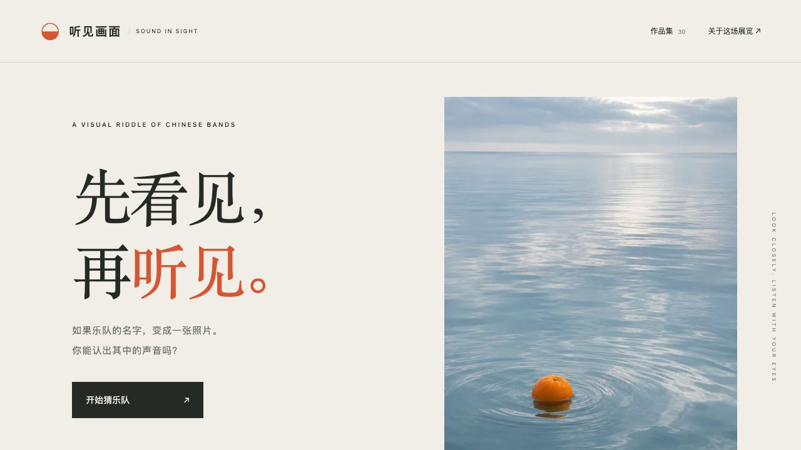

# 听见画面 / Sound in Sight

中文：把30支华语摇滚及独立乐队的名字，变成30幅写实摄影风格的AI影像。先看图猜名字，点击后等待3秒揭晓；支持线索、随机浏览、繁简体答案、进度保存与原图下载。照片均为1024×1536竖版2:3，包含极简风景、静物、黑白人文与超现实场景。非乐队官方作品。

English: Guess 30 Chinese rock and indie bands from original AI-created photographic riddles. Reveal each name after a three-second countdown, with optional clues, answer input, random browsing, local progress, and full-resolution downloads. Every image is a 1024×1536 portrait. Not affiliated with the bands.



## 在线体验 / Live Demo

- [Cloudflare Demo](https://xiaosang.cc/rock-in-pictures/)
- [GitHub Repo](https://github.com/holynova/rock-in-pictures)


## 本地运行 / Run locally

```sh
npm ci
npm run dev
# http://127.0.0.1:4318/
npm run check
```

## 手动发布 / Manual deployment

```sh
npm run deploy:check
npm run deploy
```

Cloudflare Workers Static Assets · `xiaosang.cc/rock-in-pictures/`

源码与部署配置均在 `main`；从同一提交本地手动发布，无Cloudflare自动部署工作流。
Source and deployment configuration share `main`; deploy manually from the same commit.

[创作提示词 / Generation prompts](./content.json) · [影像原图 / Original images](./dist/assets) · [创作说明 / Notes](./docs/creation-notes.md)
