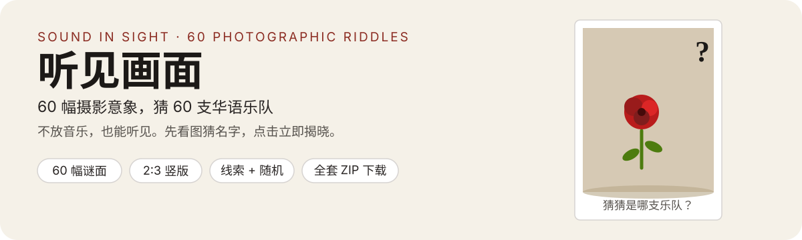
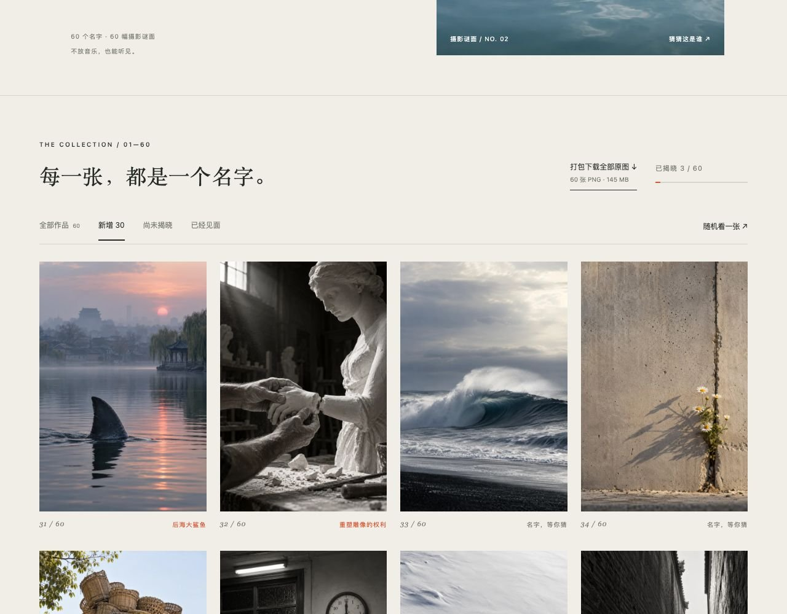

<p align="right"><a href="README.en.md">English</a></p>

<p align="center">
  
</p>

<p align="center">
  <a href="https://xiaosang.cc/rock-in-pictures/">▶ 在线猜谜</a>
  ·
  <a href="https://github.com/holynova/rock-in-pictures">GitHub 仓库</a>
</p>

把 60 支华语摇滚及独立乐队的名字，变成 60 幅写实摄影风格的 AI 影像：二手玫瑰是一朵被转赠的玫瑰，橘子海是海面上漂着的一只橙子。先看图猜名字，点击后立即揭晓；支持线索、随机浏览、繁简体答案、进度保存与单张原图下载。照片均为 1024×1536 竖版 2:3，包含极简风景、静物、黑白人文与超现实场景。非乐队官方作品。

## 截图

<p align="center">
  
</p>

<p align="center">
  
</p>

## 内容

- **60 支乐队**：内地 42、台湾 13、香港 5；二手玫瑰、橘子海、新裤子、刺猬、痛仰、万能青年旅店、五条人、海龟先生、木马、黑豹、唐朝、逃跑计划、落日飞车、草东没有派对、茄子蛋……
- **每幅的画法**：团名文字意象的独立解读，不声称解释名称真实来源；图中的人数不代表乐队实际成员人数。
- **每幅都有线索**：一句中文提示（如二手玫瑰：「一朵被转赠的浪漫。」）与一句英文创作提示词（见 `content.json`）。
- **风格**：极简风景、静物、黑白人文、超现实场景混合；全部 AI 创作，非真实拍摄。

## 功能

- **看图猜名**：图册默认隐藏乐队名字，点击照片打开谜面，点击立即揭晓。
- **答题输入**：可先输入猜测；支持繁简体、「乐队」「乐团」后缀与别名。
- **线索与随机**：每幅一句线索；「随机看一张」任意抽一幅。
- **进度保存**：揭晓进度存在浏览器本地，可按「尚未揭晓 / 已经见面」筛选，可重置。
- **下载**：答案出现后可下载无字 PNG 原图。
- **无障碍**：手机与桌面布局、键盘焦点、Esc 关闭、左右方向键切换、减少动态效果。

## 本地运行

零依赖，`dist/` 就是发布内容：

```sh
python3 -m http.server 4318 --bind 127.0.0.1 --directory dist
# 打开 http://127.0.0.1:4318
```

校验（数据与图片是否一致）：

```sh
python3 validate.py
```

## 技术

- 零框架静态站：`dist/` 是纯 HTML + CSS + JS，数据是 `dist/data.json`（60 条，不含完整创作提示词）。
- 图片三级：原始 PNG（`dist/assets/NN.png`，60 张，共约 152 MB）+ 640px 列表预览 WebP + 1024px 查看版 WebP（各 60 张）。
- 创作记录见 `docs/creation-notes.md`（第一版 30 张的记录，当前 60 张以本 README 为准）。

```
content.json            60 条完整数据：名字、地区、风格、线索、英文提示词、别名
dist/data.json          公开页面数据（不含完整提示词）
dist/assets/            60 张原始 PNG + 120 张 WebP（预览 / 查看版）
photos-*.json           原始生成路径与提示词（含第二辑）
validate.py             数据与资产一致性校验
```
